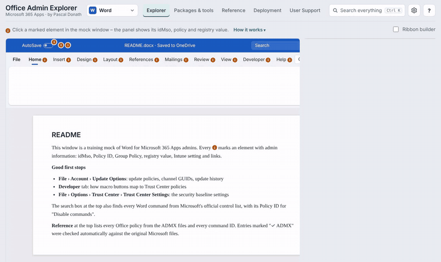
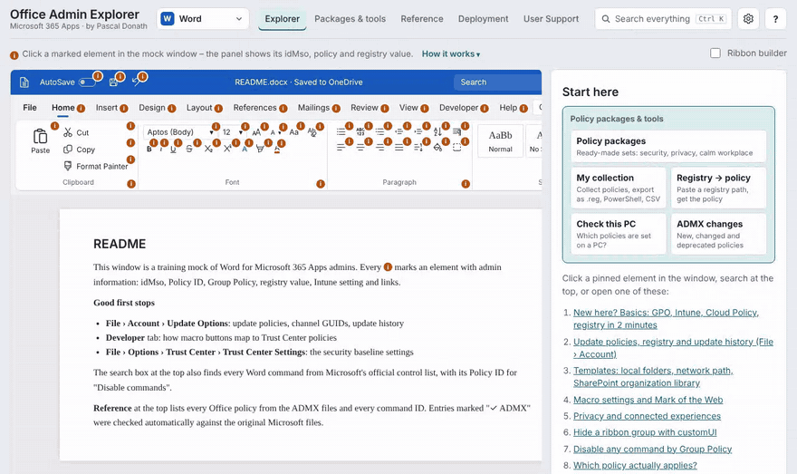
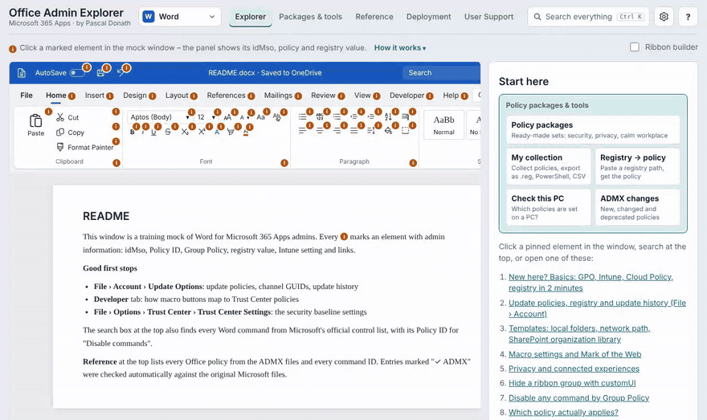
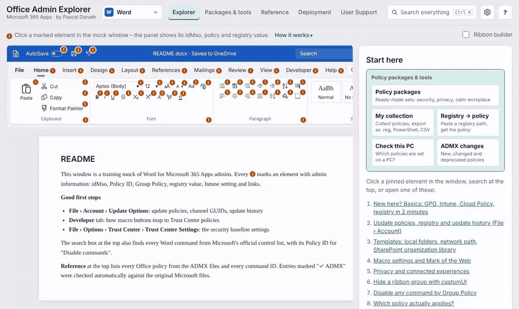

# Office Admin Explorer

**A clickable mock of Word, Excel, PowerPoint, Outlook, OneNote, Project, Access and Visio for Microsoft 365 Apps admins.**
Click any element and see how to control it centrally: idMso, Group Policy, registry value and Intune setting – in one place.

**Version 2.2** · [Changelog](CHANGELOG.md)

**▶ Open it: [tools.pascal-donath.de/office-admin-explorer](https://tools.pascal-donath.de/office-admin-explorer/)** – runs in the browser, no sign-in, nothing to install. English and German.

## Why

"Which policy controls exactly this button?" usually means searching ADMX files, the Office control ID list and the Intune settings catalog one after another. This tool connects them to the familiar Office UI.

## What you get per element

- **In plain words** – what the element does and why admins care
- **idMso** and **Policy ID** – for customUI and the "Disable commands" policy
- **Group Policy** – exact ADMX name and path, checked against Microsoft's ADMX/ADML files
- **Registry** – key, value, type and allowed values, with ready-made **PowerShell** or **.reg**
- **Intune** – the matching Settings catalog entry, linked to the [Intune Settings Catalog Viewer](https://intunesettings.app)
- **Cloud Policy**, step-by-step guides and Microsoft Learn links
- **Preview** – see the button hidden or disabled in the mock

Coverage: all **2,400+** Office ADMX policies and **8,000+** command IDs are searchable, also for elements that are not part of the mock. OneNote, Project, Access and Visio have no published command-ID list in the export used here – their pins link to the matching policy or an explained entry instead of an idMso.

**Project Server:** the Project mock shows how to connect Project Professional to Project Web App (account per script/registry – there is no ADMX policy for it), plus zone policy, local cache and check-out.

**Themes:** Auto (follows Windows), Light, Dark and High contrast.

## Ribbon builder

Switch on **Ribbon builder**, click through the mock and decide what users may not see or use:

- click a button: disabled → hidden → normal
- click a group name to hide the group, Shift+click a tab or a File-menu entry to hide it

Export the result as:

| Output | Use |
|---|---|
| `.dotx` / `.xlam` / `.ppam` | ready-made add-in without macros (Word, Excel, PowerPoint) |
| `customUI14.xml` | for your own template, add-in or COM/VSTO add-in (Outlook) |
| "Disable commands" policy | Policy IDs for Group Policy and Intune – the enforceable way |
| `.reg` / PowerShell | lab and test setups |

## More views

- **Reference** – every policy and command ID as a filterable table
- **User Support** – typical user problems: symptom → cause → fix (each case has its own link)
- **Deployment** – configuration.xml generator for the Office Deployment Tool, Group Policy setup and "which tool for what"
- **Policy packages** – three ready-made sets (security hardening, strict privacy, calm workplace) with reasons and side effects, a custom package built from a questionnaire (macros, add-ins, trusted locations, template paths, file block, saving, privacy, updates, Outlook), your own collection, registry path → policy lookup, a read-only "check this PC" script and ADMX changes. Export as `.reg`, PowerShell, GPO list or Intune list.

| Policy packages | Registry path → policy (Ctrl+K) |
|---|---|
|  |  |

Every policy, view and support case has a shareable link, and every policy has its own static page under [`/p/`](https://tools.pascal-donath.de/office-admin-explorer/p/) – registry value, GPO path, Intune settings catalog name and a PowerShell snippet to check or set it.

New here? The **tour** starts on the first visit – restart it any time from the **?** menu, which also explains how to use the results with GPO, Intune and Cloud Policy.

## Accuracy and sources

Policy names and registry values are checked automatically against Microsoft's Office ADMX/ADML templates. Intune mappings come from the Microsoft Graph settings catalog and are cross-checked with the [Intune Settings Catalog Viewer](https://github.com/Lewis-Barry/IntuneSettingsCatalogViewer) by Lewis Barry. Command IDs follow Microsoft's Office Fluent UI control lists.

This is a training and reference tool: nothing in it changes a real system. Always test configurations on a lab device or pilot group before rollout.

## Feedback

Found a wrong registry path, an outdated policy or have an idea? **[Open an issue](https://github.com/PascalDonath/office-admin-explorer/issues/new/choose)** – the link "Report it on GitHub" in the app fills in the entry for you. Please never post internal company configuration or personal data.

## Kurz auf Deutsch

Klickbare Nachbildung von Word, Excel, PowerPoint, Outlook, OneNote, Project, Access und Visio für Admins von Microsoft 365 Apps. Zu jedem Element: idMso, Gruppenrichtlinie, Registry-Wert und Intune-Einstellung, dazu der Menüband-Baukasten und ein configuration.xml-Generator. Die Oberfläche gibt es auf Deutsch und Englisch, Fehler und Ideen bitte über [Issues](https://github.com/PascalDonath/office-admin-explorer/issues/new/choose) melden.

---

Concept, content and maintenance: **[Pascal Donath](https://github.com/PascalDonath)** · Microsoft, Office, Word, Excel, PowerPoint, Outlook and Intune are trademarks of Microsoft. This project is not affiliated with Microsoft. Icons: Fluent UI System Icons (Microsoft, MIT).
